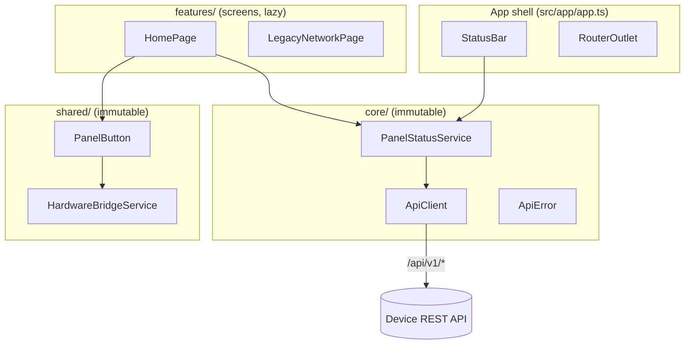

# Existing architecture — front-panel (Angular 22)

> Generated by scanning `src/` at scaffolding time. Keep it in sync when the base code changes.

## Stack

| Item | Value |
| --- | --- |
| Framework | Angular 22, standalone components, **zoneless** change detection (no zone.js) |
| State | Signals (`signal`, `computed`); RxJS only at the HTTP boundary |
| HTTP | `provideHttpClient(withFetch())`, wrapped by `ApiClient` |
| Routing | `provideRouter(routes, withComponentInputBinding())`, lazy `loadComponent` per screen |
| Unit test | `ng test` → `@angular/build:unit-test` (Vitest 5, jsdom), coverage v8 |
| E2E | Playwright (`e2e/` smoke, `.ai-dlc/outputs/generated-tests/subsystem/` Excel-derived) |
| Lint | angular-eslint (flat config `eslint.config.js`), OnPush required |

## Layers

## Directory map

| Path | Zone | Role |
| --- | --- | --- |
| `src/app/core/http/` | immutable | `ApiClient` (base URL, timeout, error normalization), `ApiError` |
| `src/app/core/panel-status/` | immutable | `PanelStatusService`: polls `GET /status`, exposes `status()` / `isOperable()` |
| `src/app/shared/hardware-bridge/` | immutable | `HardwareBridgeService`: buzzer and backlight through `window.panelBridge` |
| `src/app/shared/ui/` | immutable | `PanelButton`, `StatusBar` |
| `src/app/features/home/` | extensible (`home-page.ts`) | Home menu; append entries to `HOME_MENU` |
| `src/app/features/legacy-network/` | deletable | Old read-only network screen |
| `src/app/mocks/deprecated-*` | deletable | Unused prototype fixtures |
| `src/app/app.routes.ts`, `app.config.ts` | extensible | Append routes / providers only |
| `src/environments/environment.ts` | extensible | `apiBaseUrl`, `statusPollIntervalMs`, `requestTimeoutMs` |
| `src/styles/base-panel.scss` | immutable | Design tokens (`--panel-*`) |

## Conventions that new code must follow

- One folder per screen under `src/app/features/<feature>/`: `<feature>-page.ts` (+ `.spec.ts`).
- Feature REST access in `src/app/api/<resource>/<resource>-api.ts` (+ model + spec) using `ApiClient`.
- Screen state as signals inside the page (or a `<feature>.store.ts` when shared by several components).
- Every element listed in `ui-bindings.yaml` carries `data-ui-id="<ui-id>"` (use `PanelButton`'s `uiId` input for buttons).
