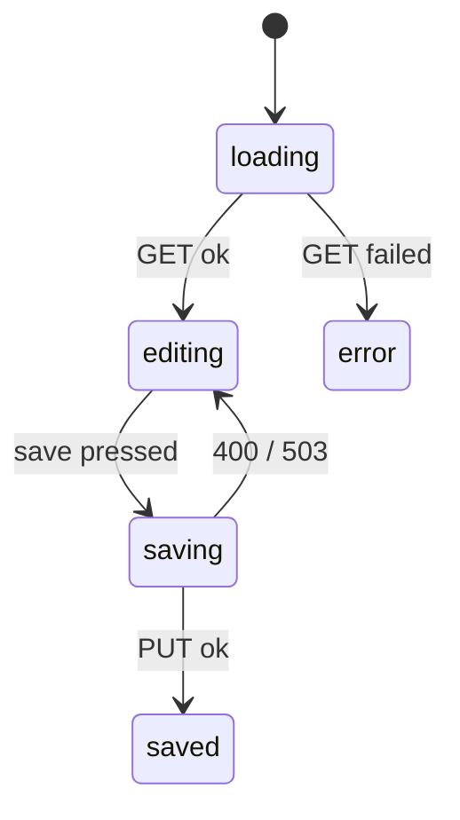

# フロントパネル画面仕様・状態遷移 / Screen and state specification

- Generated: {{generatedAt}}
- Quality gate: {{gateStatus}}

## 入力デザイン / Design inputs

{{uiDesignFiles}}

## ルーティング / Routes

{{routeTable}}

## コンポーネント / Components

{{componentTable}}

## 画面要素と API の対応 / UI ⇄ API bindings (from ui-bindings.yaml)

{{bindingMatrix}}

## デザイン → 実装の対応 / Design to implementation mapping

<!-- AI: Per screen, a table: design element (data-ui-id) | design HTML/CSS class | Angular template element | component property / signal | notes. Mark every element of the design that is NOT reproduced. -->

## 状態遷移 / State transitions

<!-- AI: One Mermaid stateDiagram-v2 per screen built from the IMPLEMENTED code (state signal and transitions), e.g.

Then a table: state | what is shown | which elements are enabled | how it is left. -->

## 組込み機器としての考慮 / Device-specific behaviour

<!-- AI: Polling (interval, stop on leave), buzzer feedback, busy handling, touch target sizes, 800x480 fit. -->

## Deviations

<!-- AI: Differences between ui-bindings.yaml / design and the implementation, with the reason. -->
