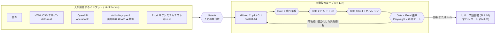

[English](README.md) | [日本語](README.ja.md)

# ai-dlc-sdk-angular

[](https://github.com/sun-flat-yamada/ai-dlc-sdk-angular/actions/workflows/ci.yml)
[](https://github.com/sun-flat-yamada/ai-dlc-sdk-angular/actions/workflows/security.yml)
[](https://angular.dev)
[](LICENSE)

**組込み機器のフロントパネル GUI（Angular）向けの、リポジトリ内蔵型 AI-DLC（AI 駆動開発ライフサイクル）SDK です。**
GitHub Copilot CLI が、要件・HTML/CSS の画面デザイン・REST API 仕様から画面を実装し、Unit Test を作成・合格させます。
さらに **人間が作成した Excel のサブシステムテスト仕様書** から生成した自動テストを最終品質ゲートとし、
合格するまで最大 **N 回** 自律的に改善を繰り返します。完了後は、人が読む観点で設計書をリバース生成し、
同じ要件を人が開発した実績と **QCD（品質・コスト・納期）** を比較します。



## 特長

| AI に組込み GUI を開発させるときの課題 | この SDK の対策 |
| --- | --- |
| HTML/CSS と OpenAPI だけでは「どのボタンがどの API を呼ぶか」「503 のとき画面はどうなるか」が書かれておらず、AI が推測する | **`ui-bindings.yaml`** で、画面要素（`data-ui-id`）と API 操作（`operationId`）、リクエスト / レスポンスの対応、画面状態、エラー時の動作を結び付ける。AI が動く前に **Gate 0** が HTML・OpenAPI・Excel との整合を機械的に検査する |
| 流用すべき既存コードを AI が書き換える | 5 つのゾーン（`immutable`、追記のみの `extensible`、`rebuildable`、`deletable`、`ignored`）からなる **境界ポリシー** を `git diff` で検査し、違反は自動で元に戻す |
| 「テスト合格」を AI 自身が判定してしまう | **最終ゲートは人が書いた Excel 仕様**。全ケースに合格したテストが必要で、期待値はハッシュで改ざんを検知し、スキップしたテストは不合格扱い |
| エージェントが手元の認証情報のまま任意のコマンドを実行してしまう | すべての処理を同梱の **Sandbox（DevContainer）** 内で実行する。非 root、no-new-privileges、既定拒否の外向き通信ファイアウォール、ホストの認証情報なし。ハーネスは **Sandbox の外では起動を拒否** する |
| エージェントのループが終わらない | **最大 N 回** で打ち切り。失敗情報を構造化して次の回に渡し、上限到達時は未解決課題をまとめて出力 |
| AI の成果物をレビューしにくい | 人の解釈軸 4 つ（流用と差分、画面と状態遷移、API シーケンス、要件 ⇄ テスト追跡）で **設計書をリバース生成** |
| 費用対効果がわからない | **QCD レポート**：合格率の推移、カバレッジ、バグ数、AI クレジット / トークン、人の工数、リードタイムを人の実績と比較 |

## クイックスタート

すべての処理は同梱の **Sandbox** 内で実行します（[docs/sandbox.md](docs/sandbox.md)、英語）。ホストに必要なのは
Docker と Node.js だけで、ホスト側で `npm ci` は実行しません。VS Code の **Reopen in Container** でも同じ環境が開きます。

```bash
npm run sandbox -- up            # Sandbox をビルドして起動（ファイアウォール、npm ci、Copilot CLI、Chromium）
npm run sandbox -- shell         # Sandbox 内のシェル。以降のコマンドはここで実行

npm run aidlc:parse-excel        # Excel を subsystem-cases.json に変換
npm run aidlc:validate-inputs    # Gate 0 と画面要素 ⇄ API の対応表 (binding-matrix.md)
npm run aidlc:init-check -- --dry-run
npm run aidlc:run -- --max-iterations 3 --dry-run   # Copilot を呼ばずに全工程を通す
```

実際の実行には [GitHub Copilot](https://docs.github.com/ja/copilot/how-tos/copilot-cli) の契約と、未コミットの変更がない作業ツリーが必要です。
Copilot CLI は Sandbox に導入済みです。

```bash
copilot login                    # Sandbox 内で 1 回だけ（またはホストで COPILOT_GITHUB_TOKEN を設定）
npm run aidlc:init-check
npm run aidlc:run -- --max-iterations 5
```

ホストから 1 コマンドずつ実行することもできます: `npm run sandbox -- exec npm run aidlc:run -- --max-iterations 5`

結果の出力先は `.ai-dlc/outputs/reports/`（最終ゲート、未解決課題、QCD）、`.ai-dlc/outputs/reverse-docs/`、
`.ai-dlc/outputs/telemetry/run-history.json` です。

> 実際に実行する前に [SECURITY.md](SECURITY.md) を読んでください。エージェントはツール権限付きで動作します。
> `aidlc:*` コマンドはすべて Sandbox の外では起動を拒否します（`aidlc.config.yaml` の `sandbox.enforce: strict`）。

プルリクエストは CI 成功後に `npm run pr:finish -- <PR 番号>`（ホストで実行）が承認と rebase merge まで自動で行います
（PR Auto-Pilot、既定で有効。[docs/pr-auto-merge.md](docs/pr-auto-merge.md)、英語）。

## 既存の Angular リポジトリへの導入

```bash
npm run aidlc:install -- --target ../your-panel-app --dry-run   # 変更内容の確認
npm run aidlc:install -- --target ../your-panel-app
```

ハーネス・Skills・インプットの雛形と Sandbox（`.devcontainer/`、`scripts/sandbox.ts`）をコピーし、`aidlc:*` / `sandbox`
スクリプトと devDependencies を追加します。`src/` には触れません。導入後、対象リポジトリで `npm run sandbox -- up` を実行してください。
導入後は `boundary-policy.yaml` と `.ai-dlc/references/` を対象のコードベースに合わせて書き換えてください。
詳しくは [docs/adoption-guide.md](docs/adoption-guide.md)（英語）を参照してください。

## インプットの考え方（方式 B: バインディング定義）

HTML/CSS は「画面に何があるか」、OpenAPI は「機器が何を受け付けるか」を表します。両者をつなぐ情報、つまり要素・イベント・API・状態・エラー処理の対応を、
`ui-bindings.yaml` という 1 か所に、両側の安定した ID（`data-ui-id` と `operationId`）で記述します。
Excel のテストケースも `@ui-id` で要素を指すため、要件からデザイン、API、テストまでを機械的に追跡できます。
詳細と根拠は [docs/input-format.md](docs/input-format.md) を参照してください。

## ライセンス

[MIT](LICENSE)
