[English](README.md) | [日本語](README.ja.md)

# ai-dlc-sdk-angular

[](https://github.com/sun-flat-yamada/ai-dlc-sdk-angular/actions/workflows/ci.yml)
[](https://github.com/sun-flat-yamada/ai-dlc-sdk-angular/actions/workflows/security.yml)
[](https://angular.dev)
[](https://docs.github.com/copilot/how-tos/copilot-cli)
[](LICENSE)

**An in-repository AI-DLC (AI-driven development life cycle) SDK for Angular GUIs of embedded device front panels.**
GitHub Copilot CLI implements a screen from requirements, an HTML/CSS design and a REST API specification,
writes and passes the unit tests, and keeps iterating — at most **N** times — until automated tests derived
from the **human-written Excel subsystem test specification** pass. Afterwards it reverse-generates design
documents along human interpretation axes and compares **QCD** (quality, cost, delivery) with the human
development of the same requirement.

```mermaid
flowchart LR
  subgraph inputs["Human inputs (.ai-dlc/inputs)"]
    R[Requirements]
    D["HTML/CSS design<br/>data-ui-id"]
    A["OpenAPI<br/>operationId"]
    B["ui-bindings.yaml<br/>UI ⇄ API ⇄ states"]
    X["Excel subsystem tests<br/>@ui-id"]
  end
  G0{{"Gate 0<br/>input consistency"}}
  subgraph loop["Self-healing loop (i = 1..N)"]
    C["GitHub Copilot CLI<br/>skills 01-04"]
    G1{{"Gate 1 boundary"}}
    G2{{"Gate 2 build + lint"}}
    G3{{"Gate 3 unit + coverage"}}
    G4{{"Gate 4 Excel-derived<br/>Playwright = final gate"}}
  end
  P["Reverse design docs (skill 05)<br/>QCD report (skill 06)"]
  inputs --> G0 --> C --> G1 --> G2 --> G3 --> G4
  G4 -- fail: structured failures --> C
  G4 -- pass or i = N --> P
```



## Why

| Problem when an AI develops embedded GUIs | What this SDK does |
| --- | --- |
| HTML/CSS and OpenAPI do not say *which button calls which API* or *what the screen does on 503* — the AI guesses | **`ui-bindings.yaml`** binds design elements (`data-ui-id`) to API operations (`operationId`), request / response mapping, screen states and error handling; **Gate 0** checks it against the HTML, OpenAPI and Excel before any AI work |
| The AI rewrites code it should only reuse | **Boundary policy** with five zones (`immutable`, `extensible` = append-only, `rebuildable`, `deletable`, `ignored`) enforced with `git diff` and automatic revert |
| "Tests pass" is decided by the AI itself | The **final gate is the human Excel specification**: every case must have a passing Playwright test, expected values are hashed and protected, skipped tests fail the gate |
| Unbounded agent loops | **Max N iterations** with structured failure feedback, then an unresolved-issues summary |
| AI output is hard to review | **Reverse design docs** on four human axes (reuse/delta architecture, screen & state spec, API sequences, requirement ↔ test traceability) |
| "Is it worth it?" | **QCD report**: pass-rate trend, coverage, defects, AI credits / tokens, human effort and lead time vs. the human baseline |

## Quick start

```bash
npm ci
npx playwright install chromium

npm run aidlc:parse-excel        # Excel -> .ai-dlc/outputs/generated-tests/subsystem-cases.json
npm run aidlc:validate-inputs    # Gate 0 + binding matrix (.ai-dlc/outputs/reports/binding-matrix.md)
npm run aidlc:init-check -- --dry-run
npm run aidlc:run -- --max-iterations 3 --dry-run   # whole pipeline without calling Copilot
```

Real run (needs [GitHub Copilot CLI](https://docs.github.com/copilot/how-tos/copilot-cli) and a clean git tree):

```bash
npm install -g @github/copilot && copilot login
npm run aidlc:init-check
npm run aidlc:run -- --max-iterations 5
```

Results: `.ai-dlc/outputs/reports/` (final gate, unresolved issues, QCD), `.ai-dlc/outputs/reverse-docs/`,
`.ai-dlc/outputs/telemetry/run-history.json`.

> Read [SECURITY.md](SECURITY.md) before a real run: the agent runs with tool permissions. Use an isolated environment.

## Use it in your existing Angular repository

```bash
npm run aidlc:install -- --target ../your-panel-app --dry-run   # preview
npm run aidlc:install -- --target ../your-panel-app
```

The installer copies the harness, skills and input skeleton, adds the `aidlc:*` scripts and devDependencies,
and never touches `src/`. Then adapt `boundary-policy.yaml` and `.ai-dlc/references/` to your code base.
See [docs/adoption-guide.md](docs/adoption-guide.md).

## Commands

| Command | Purpose |
| --- | --- |
| `npm run aidlc:init-check` | Environment check (Node, git, Copilot CLI, Angular CLI, Playwright, inputs, skills) |
| `npm run aidlc:parse-excel` | Excel subsystem tests → structured JSON + checklist |
| `npm run aidlc:validate-inputs` | Gate 0: `ui-bindings.yaml` ⇄ HTML ⇄ OpenAPI ⇄ requirements ⇄ Excel; writes the binding matrix |
| `npm run aidlc:guard` | Boundary check against the baseline (`--revert`, `--snapshot`, `--baseline <ref>`) |
| `npm run aidlc:gate` | Gates 0-4 (`--only build,unit`, `--json`) |
| `npm run aidlc:run` | Full loop (`--max-iterations N`, `--dry-run`, `--skip-post`, `--allow-dirty`, `--no-revert`) |
| `npm run aidlc:reverse-doc` | Reverse design documents only |
| `npm run aidlc:qcd` | QCD comparison report (`--run-id`) |
| `npm run aidlc:schemas` | Regenerate the JSON Schema of `ui-bindings.yaml` |
| `npm run aidlc:install` | Install the SDK into another Angular repository |
| `npm run gate` | Repository quality gate (typecheck, lint, unit, harness tests, secret scan, build) |

## Repository layout

```text
.ai-dlc/
  config/        aidlc.config.yaml, boundary-policy.yaml, schemas/
  inputs/        requirements/ ui-design/ api-specs/ ui-bindings/ subsystem-tests/ human-baseline/  (sample: REQ-NET)
  references/    existing-architecture, reusable-catalog, panel-hardware-constraints, coding-and-test-conventions
  tools/         orchestrator, copilot-cli-adapter, boundary-guard, excel-to-test-ast, validate-inputs,
                 gate-runner, qcd-calculator, subsystem-kit, install, tests/
  outputs/       generated-tests/ reverse-docs/ telemetry/ reports/   (generated, git-ignored)
.github/skills/  01-context-and-boundary … 06-qcd-benchmark (Agent Skills for Copilot CLI)
src/             sample "existing" Angular 22 front-panel app (800×480, zoneless, signals)
docs/            architecture, input format, adoption guide
```

## Documentation

- [Architecture](docs/architecture.md) — loop, gates, telemetry, safety model
- [Input format](docs/input-format.md) — why and how to bind HTML/CSS to the REST API (`ui-bindings.yaml`, Excel notation)
- [Adoption guide](docs/adoption-guide.md) — install into an existing repository, tune the boundary policy, run a pilot
- [Original specification](specs/2026-11-18_scaffolding-ai-dlc-sdk-angular/spec.md) (Japanese)

## Status

`0.1.0` — the harness, skills, input validation and dry-run pipeline are tested in CI. Gates 0-4 were also
verified end to end against a reference implementation of the sample screen (not committed, because the
sample code base must stay in its "before" state): build, lint, 37 unit tests at 99 % line coverage and 8/8
Excel-derived Playwright cases passed, and wrong texts, skipped tests and append-only violations were
rejected. Real Copilot CLI runs depend on your Copilot plan and environment; please report results and issues.

## License

[MIT](LICENSE)
