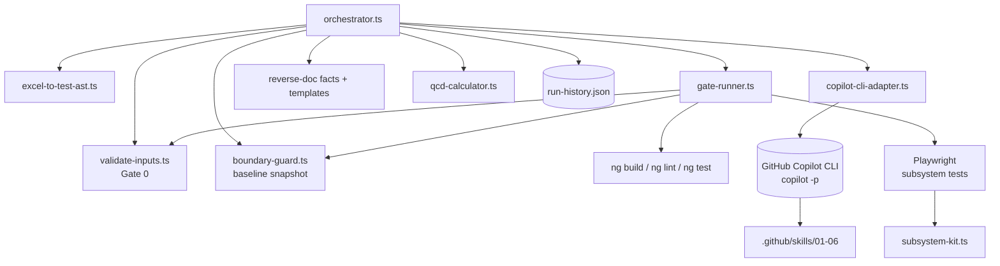

# Architecture

## Components



| Module | Responsibility |
| --- | --- |
| `orchestrator.ts` | Modes `validate-env`, `full-loop`, `reverse-doc`. Prepares the run (Excel → JSON, Gate 0, baseline snapshot), drives iterations 1..N, writes reports, runs post-processing. |
| `copilot-cli-adapter.ts` | Writes the prompt to `<id>.prompt.md`, runs `copilot -p "<read the prompt file>" …` with the argument template from `aidlc.config.yaml`, records duration, prompt size, usage (`--usage-output-file`), transcript (`--share`) and the files changed by the call. `--dry-run` skips the process call. |
| `validate-inputs.ts` | Gate 0. Cross-checks `ui-bindings.yaml` with the design HTML, OpenAPI (operations, request properties, response paths, error responses) and requirement IDs, and the Excel cases with all of them (`@ui-id` references, API responses / expected requests against OpenAPI, requirement IDs and coverage of every screen requirement). Writes `binding-matrix.md`. |
| `boundary-guard.ts` | Classifies every change since the baseline (`git diff` + untracked files) into zones and reverts violations. |
| `excel-to-test-ast.ts` | Detects the header row, maps English / Japanese headers, parses steps, mocked API responses, expected UI / CSS / API, `@ui-id` references. Hashes the cases. |
| `gate-runner.ts` | Runs gates in order; a failing gate turns the following gates into `skipped`. Parses tool output into `{ where, message }` failures for the fix prompt. |
| `subsystem-kit.ts` | Playwright helpers for generated tests: `loadCase`, `ui`, `mockDeviceApi`, `expectApiRequests`, `expectNoRequest`, `expectCss`. Expected values always come from the JSON. |
| `qcd-calculator.ts` | QCD metrics from the run history and `human-qcd.json`; Markdown (ja / en) + JSON. |
| `install.ts` | Copies the SDK (including the sandbox) into another Angular repository. The only command allowed outside the sandbox. |
| `lib/sandbox.ts`, `sandbox-check.ts` | Detects the sandbox (`AIDLC_SANDBOX` + container marker, firewall marker bound to PID 1, live egress probe, host credential bridges) and enforces `sandbox.enforce` at the start of every CLI entry point. |

## The loop

1. **Prepare** — parse Excel, run Gate 0 (abort on errors), record `baseline.json`
   (`HEAD` SHA + SHA-256 of the cases).
2. **Iteration i**
   - Prompt: i = 1 → skills 01, 03, 02 with all inputs (test-first: the Excel cases are mapped in the change
     impact map, turned into Playwright tests, then implemented against); i > 1 → skill 04 with the failures of i − 1.
   - Copilot CLI call (non-interactive).
   - Gates: 0 inputs → 1 boundary (auto-revert) → 2 build, lint → 3 unit + coverage → 4 subsystem.
   - All `pass` → stop. Otherwise write `iter-i/gate-results.md` and continue.
3. **Finish** — `final-quality-gate.md`; `unresolved-issues.md` when N was reached; change statistics per zone.
4. **Post-process** — facts → templates (`reverse-docs/*.md`) → Copilot completes them (skill 05);
   QCD report → Copilot adds the interpretation (skill 06).

`skipped` never counts as `pass`. In dry-run mode gates 2-4 are skipped, so the loop runs exactly N times and
ends as `exhausted` — that exercises the bound and the reports. `--simulate-pass-at k` exercises the early exit.

## Boundary revert

git does not see git-ignored paths, so `ignored` zones such as `node_modules/` are protected separately
(`lib/dependency-guard.ts`, `loop.dependencyGuard`). Before the first agent call the orchestrator
fingerprints every entry under `node_modules/` (path, type, mode, size, inode, mtime and ctime in
nanoseconds) and keeps it in memory. A write always changes the ctime, which user space cannot set back.
Gate 1 fails on any difference, rebuilds the directory with `npm ci` from the immutable lockfile and
fingerprints it again. `.angular/cache` is deleted before the gates, and `dist/`, `coverage/` and the
Playwright report are regenerated (or deleted) by the gates themselves. Standalone `aidlc:gate` /
`aidlc:guard` have no trusted fingerprint and check git-visible paths only.

A violating file is restored to its baseline content **as a whole** (a new file in a protected zone is
deleted). In an `extensible` file this also drops the allowed additions made in the same file; the
violation is reported to the next iteration, which re-applies the change as a pure addition.

## Final gate integrity

Gate 4 passes only when:

- the cases in `subsystem-cases.json` are exactly the cases re-parsed from the Excel workbooks in
  `.ai-dlc/inputs/subsystem-tests/` and, inside the loop, the hash the orchestrator computed at the start
  of the run and keeps in memory (expected values unchanged). Files under `.ai-dlc/outputs/` — including
  the file's own `casesSha256` and `baseline.json` — are writable by the agent and git-ignored, so they
  are never the only reference; inside the loop a missing or modified `baseline.json` also fails the gate,
- every case ID has at least one test whose title contains `[<case ID>]`, and all of them passed,
- no test is skipped, no test refers to an unknown case ID,
- the pass rate is ≥ `gates.subsystem.minPassRate` (default 1.0).

## Telemetry (`run-history.json`)

```text
runs[]: runId, mode, startedAt, endedAt, dryRun, maxIterations, baseline, result, changeStats
  iterations[]: index, copilotCalls[], gates[], passed
    copilotCalls[]: skills, phase, duration, promptChars, estimated tokens, usage {aiCredits, premiumRequests, tokens}, changedFiles
    gates[]: gate, status, summary, failures[], metrics {coverage*, passRate, warnings, …}
  postProcess[]: copilotCalls of skills 05 / 06
```

## Safety model

See [SECURITY.md](../SECURITY.md) and [sandbox.md](sandbox.md). In short: every command runs in the
bundled sandbox (dev container: non-root, no-new-privileges, default-deny egress firewall, no host
credentials) and the harness refuses to run outside it (`lib/sandbox.ts`); explicit allow / deny tool
rules for Copilot CLI, no git write commands for the agent, mechanical boundary revert (the sandbox
definition itself is `immutable`), protected inputs and expected values. A dry-run reports boundary
violations but never reverts, because no agent ran.
