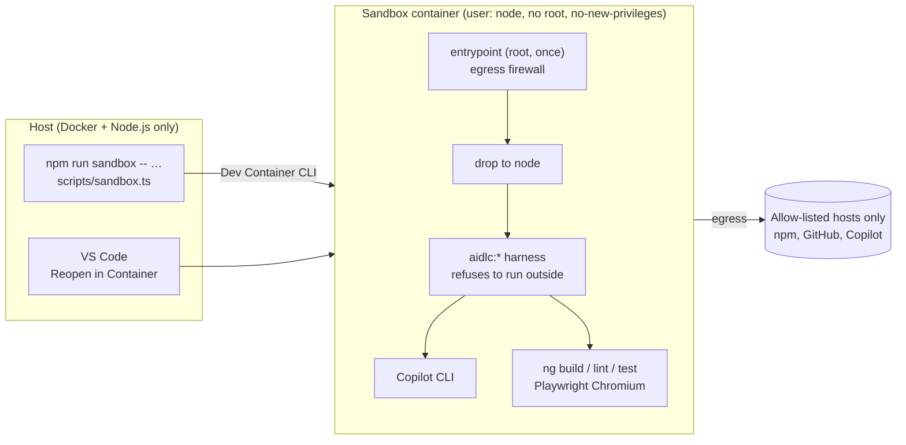

# Sandbox (dev container)

The SDK ships its own isolated execution environment in [`.devcontainer/`](../.devcontainer/).
**Every SDK operation runs inside it**: installing dependencies, the AI-DLC loop with GitHub Copilot
CLI, the gates (Angular build / lint / unit tests, Playwright), the repository quality gate and CI.
The host needs only **Docker** and **Node.js** (to start the launcher); it never runs `npm ci`, the
agent or any project code.



## Quick start

```bash
npm run sandbox -- up                         # build the image (first time) and start; runs npm ci inside
npm run sandbox -- exec npm run aidlc:init-check
npm run sandbox -- exec npm run aidlc:run -- --max-iterations 3 --dry-run
npm run sandbox -- shell                      # interactive shell (then: copilot login, npm run …)
npm run sandbox -- down                       # remove the container (volumes are kept)
```

`npm run sandbox` works before `npm ci`: [`scripts/sandbox.ts`](../scripts/sandbox.ts) uses only
Node.js built-ins and runs the pinned [Dev Container CLI](https://github.com/devcontainers/cli)
through `npx`. With VS Code, use **Dev Containers: Reopen in Container** instead — and first set the
VS Code user settings `"dev.containers.copyGitConfig": false` and
`"dev.containers.gitCredentialHelperConfigLocation": "none"`. Otherwise VS Code forwards your host
git credentials into the container and the harness refuses to run (see below).

Authenticate Copilot CLI **inside** the sandbox, once: `copilot login` (the state is kept in the
`aidlc-copilot-*` volume), or set `COPILOT_GITHUB_TOKEN` on the host before `up` — a fine-grained
token with the _Copilot Requests_ permission only. Host credentials are never mounted.

## What isolates what

| Layer | Mechanism | Defined in |
| --- | --- | --- |
| File system | Only the repository is bind-mounted (`/workspace`). No home directory, SSH keys, cloud credentials or Docker socket. `node_modules` lives in a named volume, so Linux binaries never reach the host. | `devcontainer.json` (`workspaceMount`, `mounts`) |
| Privileges | Processes run as `node`. No `sudo` in the image, `--security-opt=no-new-privileges`, `--cap-drop=ALL` (only `NET_ADMIN`, `NET_RAW`, `SETUID`, `SETGID` remain, used by the root entrypoint), `--pids-limit`. | `Dockerfile`, `devcontainer.json` (`runArgs`) |
| Network | Default-deny egress firewall (iptables + ipset) applied **as root by the entrypoint on every container start**, before any user process. Only DNS and the hosts in `allowed-domains.txt` (+ GitHub's published ranges) are reachable; everything else is rejected. Verified at start (a non-listed host must fail). | `entrypoint.sh`, `init-firewall.sh`, `allowed-domains.txt` |
| Tools | Copilot CLI and Playwright Chromium are baked into the image at pinned versions, so the agent never downloads tools at run time. | `Dockerfile`, `devcontainer.json` (`build.args`) |
| Credentials | SSH agent forwarding is cleared, git uses no credential helper, VS Code git authentication is disabled. | `devcontainer.json`, `post-create.sh` |
| Harness | Every `aidlc:*` command (except `aidlc:install`) checks the sandbox before doing anything and refuses to run outside it. | `.ai-dlc/tools/lib/sandbox.ts` |
| Code base | The boundary guard marks `.devcontainer/**` and `scripts/sandbox.ts` as `immutable`; the agent cannot weaken its own sandbox. | `.ai-dlc/config/boundary-policy.yaml` |

## Enforcement by the harness

`.ai-dlc/config/aidlc.config.yaml`:

```yaml
sandbox:
  enforce: strict # strict | agent | off
  kind: devcontainer # expected value of AIDLC_SANDBOX
  requireEgressFirewall: true
  forbidHostCredentialBridges: true
  egressProbeHost: example.com # must NOT be reachable
```

| `enforce` | Refuses outside the sandbox |
| --- | --- |
| `strict` (default) | every `aidlc:*` command and `npm run gate` |
| `agent` | only commands that start Copilot CLI or execute project code (`aidlc:run`, `aidlc:gate`, `aidlc:reverse-doc` without `--dry-run`, `npm run gate`) |
| `off` | nothing (not recommended) |

A command is accepted only when **all** of the following hold — none of them can be produced by the
agent from inside a sandbox user process:

1. `AIDLC_SANDBOX` equals `sandbox.kind` (set by `containerEnv`) **and** a container runtime marker
   exists (`/.dockerenv` or `/run/.containerenv`). Setting the variable on the host is not enough.
2. The firewall marker `/run/aidlc-sandbox/egress-firewall` (root-owned) says `enforced` and carries
   the start time of the current PID 1 — a marker from before a container restart is `stale`.
3. A live TCP connection to `egressProbeHost` is refused.
4. No host credential bridge is visible (`SSH_AUTH_SOCK`, a VS Code git credential helper,
   `VSCODE_GIT_IPC_HANDLE`).

`npm run aidlc:sandbox-check` prints the status; `npm run aidlc:init-check` includes it.

## Configuration

| Need | How |
| --- | --- |
| Allow another host (for example an internal npm registry) | Add it to `.devcontainer/allowed-domains.txt` and rebuild (`npm run sandbox -- rebuild`), or set `AIDLC_FIREWALL_EXTRA_DOMAINS=host1,host2` on the host before `up` |
| Corporate proxy | Set `HTTPS_PROXY` / `HTTP_PROXY` / `NO_PROXY` on the host before `up`; the proxy host is allowed automatically and the proxy's own policy applies. A proxy on the host's `127.0.0.1` is not reachable from the container. |
| TLS-inspecting proxy | Put its CA certificate as `.devcontainer/certs/<name>.crt` (git-ignored) and rebuild |
| Debug without the firewall | `AIDLC_FIREWALL=off` on the host before `up`. The harness then refuses to run while `requireEgressFirewall: true` |
| Different Copilot CLI / Playwright version | `build.args` in `devcontainer.json`. `PLAYWRIGHT_VERSION` must equal the locked `@playwright/test` (a harness test checks it) |

## CI

[`.github/workflows/ci.yml`](../.github/workflows/ci.yml) builds the same image with
[`devcontainers/ci`](https://github.com/devcontainers/ci) and runs every check inside it, including
the sandbox check, the harness dry-run and the Playwright E2E tests.

## Known limits

- DNS (port 53) is allowed so that host names can be resolved; DNS tunnelling is not blocked.
- Allowed hosts are resolved to IP addresses when the container starts. CDNs rotate addresses;
  restart the container (`npm run sandbox -- down && npm run sandbox -- up`) if a host stops working.
- With a proxy, the proxy decides what is reachable.
- A container shares the host kernel. For stronger isolation run Docker inside a VM (Docker Desktop
  does this on Windows and macOS) or use a dedicated, disposable runner.
- VS Code may still inject its own credential helper when you attach with VS Code; the harness then
  refuses to run (`forbidHostCredentialBridges`). Set the VS Code user settings
  `"dev.containers.copyGitConfig": false` and
  `"dev.containers.gitCredentialHelperConfigLocation": "none"`, or use `npm run sandbox` for agent
  runs.
